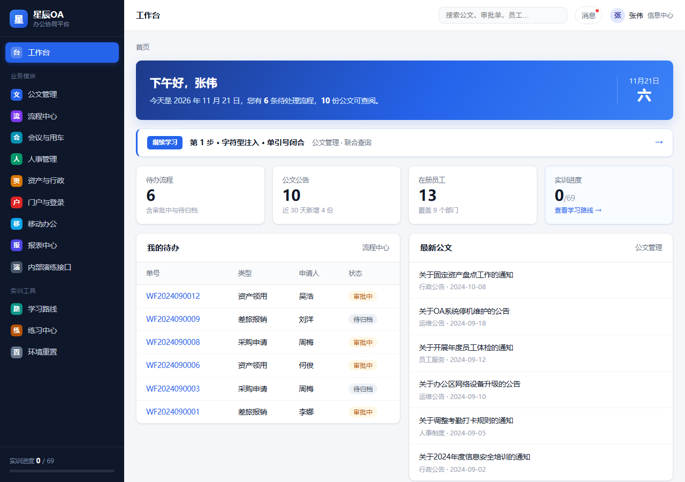
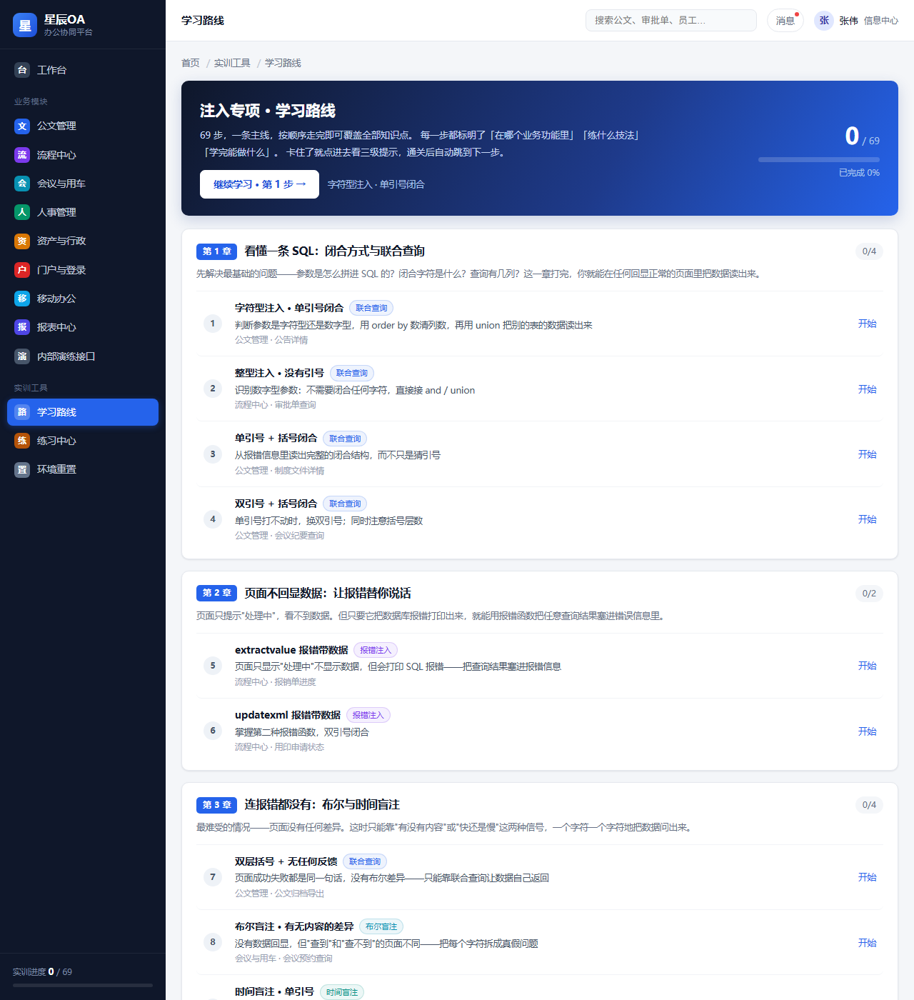
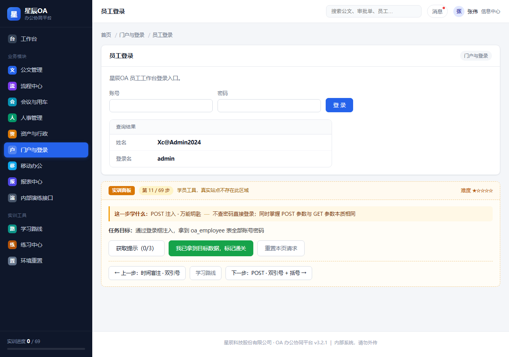

# sqli-labs-oa

**星辰OA · 业务化 SQL 注入实训环境**

把 sqli-labs 的 65 关拆开，重新装进一套企业办公系统里。69 个业务入口，没有一个页面写着「Level」。

作者：**Ninggo** ｜ 基于 [sqli-labs](https://github.com/Audi-1/sqli-labs) 二次开发



---

## 和原版的区别

| | 原版 sqli-labs | 本项目 |
|---|---|---|
| 页面长什么样 | 白底黑字，标题写着 SQL Injection Lab | 完整的 OA 界面：左侧业务导航、顶部搜索、待办与公告 |
| 参数叫什么 | `?id=1` | `?notice_id=1`、`?wf_no=GF-2024-0017`、`?sort=hiredate` |
| 查询成功返回什么 | `Your Login name: Dumb` | 一条真实公文：标题、正文、发文部门、成文日期 |
| 账号密码在哪 | `users` 表，就在回显里 | `oa_employee` 人事主数据，得注入才挖得到 |
| 通关标准 | 页面上看到数据 | 挖出员工登录名与密码，回填到关卡页校验 |
| 关卡数 | 65 | 69（含 4 个 a 系列变体） |
| 学习顺序 | 按编号 1→65 | 10 章 69 步，按知识点排，编号打乱 |
| 源码 | 每关一个 index.php | 统一框架 + `challenges/Less-N.php` 单文件定义 |

最核心的一条是**账号密码在哪**。原版第 1 关直接回显 `Dumb`，学员学到的是「union select 能出数据」；这里第 1 关返回的是一条公文，账号密码躺在另一张你还没权限看的表里，学员学到的是「先判断这是什么系统，再想值钱的数据会在哪张表」。

---

## 具体做了什么

不是换皮肤。后端重写，数据重建，69 关逐关重做。

**业务外壳重做。** 「星辰科技 OA 办公协同平台 v3.2.1」，9 个业务模块 69 个功能入口——公文、审批、报销、用印、通讯录、资产、移动端接口、人事系统、报表。每一页都是能点、能查、能翻页的正常功能。

**数据重建。** 13 名员工的完整花名册（工号、姓名、登录名、密码、部门、职位、邮箱、手机、入职日期），10 条公文，12 条审批单，外加终端准入审计和登录来源审计两张日志表。密码明文存放，模拟老系统历史遗留——真实世界里这种情况比你想的多。

**注入点保持原位。** 参数名与原版一致（`id`、`uname`、`passwd`、`sort`、Cookie `uname`），历史 payload 和 sqlmap 可以直接跑。改的只是外壳，不是手法。

**目标统一。** 69 个入口，绝大多数指向同一件事：通过注入，从 `oa_employee` 里把员工的登录名和密码挖出来。

---

## 特点

**没有靶场痕迹。** 页面上没有「Level 1」，没有「请输入 payload」，没有「恭喜通关」。底部写着「内部系统，请勿外传」——学员第一次打开会真的以为这是个 OA。

**两条学习路径。** 「学习路线」把 69 关按知识点排成 10 章 69 步，每一步写清这一步学什么、在哪个功能里、关键手法是什么；「练习中心」按训练阶段 01~07 重新分组。编号和知识点是解耦的，第 36 步对应的可能是 Less-32。

**业务区和调试区分离。** 每个功能页上半部分是学员该看到的东西，下半部分折叠着后端拿到的 SQL 原文。卡住的时候展开看一眼，比对着教程猜快得多。

**技术细节是真的。** 宽字节关卡用 `SET NAMES gbk` 而不是 `set_charset`——新版 PHP 的转义函数是 charset-aware，用后者绕过会被堵死；堆叠注入真的会改库，打完记得改回来；挑战关的表名和密钥每次重置都变；`secure_file_priv` 默认 NULL，写文件那几关会明确告诉你为什么打不出去。



---

## 快速开始

需要 PHP 7.2+ / 8.x 和 MySQL 5.7+，推荐 phpStudy。

**1. 放到网站根目录**

解压到 `D:\phpstudy_pro\WWW\`，得到：

```
WWW\app\                 靶场主程序
WWW\sql-connections\     数据库连接配置
WWW\使用说明.txt          完整部署与使用说明
```

**2. 开启 mysqli 扩展**

`php.ini` 里找到 `extension=mysqli`，去掉前面的分号，重启 Web 服务。phpStudy 面板在「软件管理 → PHP 版本 → 配置 → 扩展」里勾选更省事。

**3. 改数据库密码**

编辑 `sql-connections\db-creds.inc`：

```php
$dbuser = 'root';
$dbpass = 'root';        // 改成你自己的 MySQL 密码
$host   = 'localhost';
$dbname = 'security';
$dbname1= 'challenges';
```

**4. 初始化数据库**

访问 `http://127.0.0.1/app/setup.php`，页面会逐条显示建库、建表、写入业务数据的结果，全绿即成功。

**5. 开始练习**

访问 `http://127.0.0.1/app/index.php`。

如果解压目录不是 WWW 根目录（比如放在 `WWW\oa\` 下），地址相应变成 `http://127.0.0.1/oa/app/setup.php`。

---

## 关卡总览

69 个入口按手法归类。同一类手法分散在不同业务模块里，避免「第 1 关一定是 union」这种规律。

| 手法 | 数量 | 入口示例 |
|---|---|---|
| 联合查询 | 5 | 公告详情、审批单查询、制度文件详情、会议纪要 |
| 报错注入 | 4 | 报销单进度、用印申请状态、企业邮箱登录 |
| 布尔盲注 | 1 | 会议预约查询 |
| 时间盲注 | 4 | 车辆预约、会议室预约、账号找回 |
| 登录绕过 | 2 | 员工登录、渠道员工登录 |
| UPDATE 注入 | 1 | 密码修改（自助服务） |
| 请求头注入 | 2 | 终端准入登记（UA）、登录来源审计（Referer） |
| Cookie 注入 | 3 | 员工工作台、加密会话、移动端会话 |
| 宽字节 | 6 | 人事系统接口、人事系统登录 |
| 堆叠注入 | 8 | 数据报表接口、OA 后台登录、客服工作台 |
| ORDER BY | 8 | 员工列表排序、绩效榜单、报表排序 |
| 二次注入 | 1 | 新员工账号激活 |
| 过滤绕过 | 9 | 通讯录查询、外出登记、公文检索、资产领用 |
| WAF 绕过 | 3 | 移动审批/考勤/公告接口（HTTP 参数污染） |
| 综合挑战 | 12 | 内部演练接口，限 10 次，超次自动重置 |

业务模块分布：

| 模块 | 入口数 | 包含 |
|---|---|---|
| 公文管理 | 7 | 公文、制度、纪要、归档导出、检索 |
| 流程中心 | 8 | 报销、用印、采购、外出报备、审批统计 |
| 会议与用车 | 3 | 会议室、会议预约、车辆预约 |
| 人事管理 | 9 | 通讯录、账号激活、密码修改、老版人事接口 |
| 资产与行政 | 3 | 资产领用、办公用品、资产编号查询 |
| 门户与登录 | 11 | 各类登录入口、终端准入、来源审计、工作台 |
| 移动办公 | 5 | 移动审批/考勤/公告、加密会话 |
| 报表中心 | 11 | 经营报表、审批统计、通讯录排序 |
| 内部演练接口 | 12 | 限 10 次的综合挑战 |



---

## 适合谁

**讲 SQL 注入的老师。** 学员在 sqli-labs 上打得行云流水，一到真实项目就找不到注入点——问题不在手法，在场景。这套环境专门用来补这一课。

**自学到瓶颈的人。** 手工注入会了，但不知道真实系统里怎么找注入点、怎么判断闭合、怎么在没有回显的时候继续。学习路线从第 1 步排到第 69 步。

**打 CTF 想转实战的人。** CTF 的注入题参数友好、回显明确；这里参数要自己从页面里翻，回显经常没有，还得先判断这是个什么系统。

---

## 目录结构

```
app/
  index.php              工作台首页
  path.php               学习路线（69 步线性主线）
  train.php              练习中心（按阶段 01~07 分组）
  module.php             业务模块列表
  challenge.php          关卡运行时
  setup.php              一键重建数据库
  challenges/            Less-1 ~ Less-65 关卡定义
  lib/                   db / layout / progress / modules / curriculum
  api/                   提示、进度接口
  assets/                样式与脚本
  data/                  进度存档（运行时生成）

sql-connections/
  db-creds.inc           数据库连接配置（含 .htaccess 禁止直接访问）
  sql-connect.php        连接封装，被 app/lib/db.php 引用

tools/                   打包、冒烟测试脚本
docs/screenshots/        README 截图
使用说明.txt              完整中文说明（部署、结构、关卡、常见问题）
```

---

## 常见问题

**提示「PHP 未启用 mysqli 扩展」**

按上面第 2 步开启，注意改完要重启 Web 服务，不是重启面板。

**提示「页面不存在，请从练习中心进入」**

说明直接访问了 `challenge.php?id=1` 但没带模块参数。从 `index.php` 点进去，或者用学习路线页的链接。

**数据库连不上**

`db-creds.inc` 里的密码要和本机 MySQL 一致。phpStudy 默认是 `root/root`，装过其他环境的话可能不同。

**`into outfile` 写不进去**

MySQL 5.7 之后 `secure_file_priv` 默认为 `NULL`，这个变量不支持运行时修改，需要改 `my.ini` 后重启。写文件那几关的说明里写了这一点。

**打完堆叠注入发现密码被改了**

正常，那几关真的会改库。进 `app/setup.php` 重新初始化即可。

---

## 免责声明

本项目仅用于 Web 安全教学与授权环境下的技能训练。

请勿将其中任何技术用于未授权的目标。使用者需自行承担因不当使用产生的一切后果，与作者无关。

---

## 致谢

- [sqli-labs](https://github.com/Audi-1/sqli-labs) —— 原始关卡设计，本项目在其基础上重做业务外壳
- 原版作者 Audi-1 及所有贡献者

原版 65 关的注入逻辑（闭合方式、过滤规则、查询结构）在 `app/challenges/` 里逐关重写，不是套壳。

---

## 关于作者

**Ninggo** —— Web 安全讲师。

做这套环境的原因很朴素：讲 SQL 注入的时候，学员在 sqli-labs 上打得行云流水，一到真实项目就找不到注入点。问题不在手法，在场景。

配套课件正在整理，会陆续放出。

---

## 许可证

MIT License。允许自由使用、修改、分发和商用，保留版权声明与作者署名即可。

详见 [LICENSE](LICENSE)。
